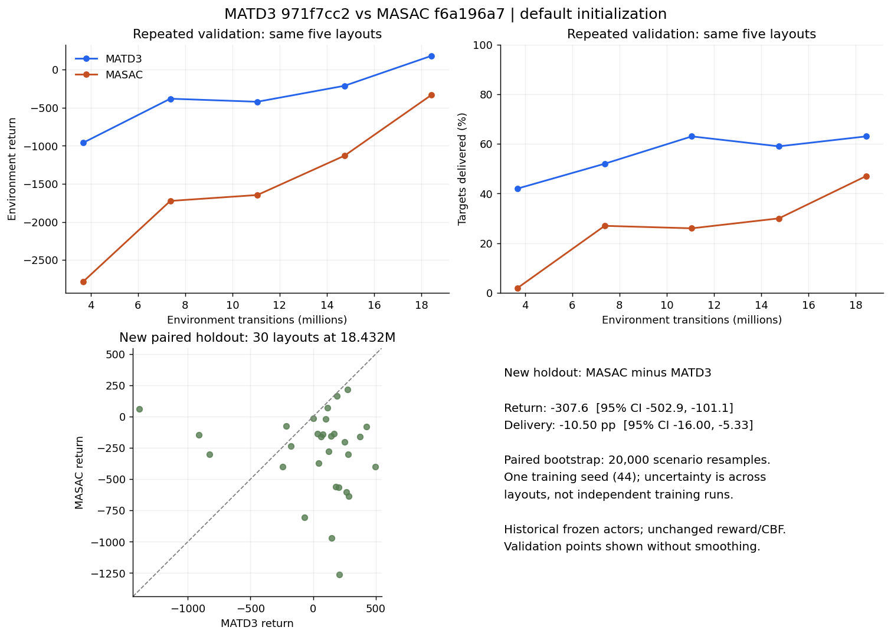

# Main-pair MASAC/MATD3 audit — 2026-11-07

This audit prioritizes MATD3 `971f7cc2` and MASAC `f6a196a7`.
Both use the default PyTorch initialization scheme. The Kaiming/orthogonal
experiments do not explain their difference. Neither ranking nor a desired
curve shape is a correctness test for an RL implementation.

## What was actually compared

| Property | MATD3 | MASAC |
|---|---|---|
| W&B run | `971f7cc2` | `f6a196a7` |
| Source commit | `458d7fbb7a304995b2316d681cdb8c9ac89042ec` | `4c9f67ca5c20289a07ebe80fc658fda5738bc3d7` |
| Initialization scheme | default | default |
| Architecture | shared local actor; one scalar team twin critic; actor LayerNorm | same sharing/LayerNorm choices |
| Execution | BASE, NOCHUNK, seed 44, FP32 | BASE, NOCHUNK, seed 44, FP32 |
| MASAC entropy support | n/a | MASKAWARE valid destinations |
| Final transitions | 21,188,608 | 24,092,672 |
| Completed training episodes | 20,000 | 20,000 |

Both use six UAVs, 20 targets, 15 obstacles, the same 3D scene generator,
Bayesian sensor, RF interface, battery model, reward and CBF. The 4096 parallel
environments, replay capacity 1M and minibatch 8192 match. A source diff between
the two commits changes MATD3 initialization support, not the environment or
MASAC implementation. Equal episode counts do not imply equal transition
budgets. Equal initialization *scheme* does not imply identical network weights
or action distributions for different algorithms.

## Matched W&B validation at 18,432,000 transitions

The same five seeds `1000000044..1000000048` and all five layout hashes match.
Both policies use deterministic evaluation. These are recurring validation
scenarios, not an unseen test set.

| Metric, mean over five episodes | MATD3 | MASAC |
|---|---:|---:|
| Environment return | 181.3447 | -331.2661 |
| Targets found (%) | 65 | 50 |
| Targets delivered (%) | 63 | 47 |
| Mission score: 10 found + 50 delivered | 760 | 570 |
| Raw unsafe attempts / UAV-step, mean episode fraction | 0.1831 | 0.2647 |
| CBF interventions / UAV-step, mean episode fraction | 0.5100 | 0.5754 |
| Observed post-filter safety violation steps | 0 | 0 |

MASAC minus MATD3 return is **-512.6107**. Its exact logged decomposition is:

| Difference component | MASAC minus MATD3 points |
|---|---:|
| Discovery reward | -30.0000 |
| Delivery reward | -160.0000 |
| Unsafe-command penalty | -185.6467 |
| CBF intervention-count penalty | -112.8167 |
| CBF correction-magnitude penalty | -12.5761 |
| Blocked-motion penalty | -27.6800 |
| Remaining terms together | +16.1088 |

The mission deficit is 190 points; the three safety-penalty differences total
311.0395. Thus the return deficit reflects both fewer completed mission events
and greater accumulated safety costs. Removing a penalty from the plotted return
would change the reported objective rather than prove better learning.
Raw unsafe proposals and actual post-filter violations must be reported
separately. CBF can intervene conservatively even when a one-step proposal is
not counted unsafe, so those rates need not be identical.

## New paired holdout: 30 previously unused layouts

The exact historical actors at 18,432,000 transitions were recovered from
Hugging Face history and SHA-256 checked against W&B. Seeds 2110000044–2110000073
were then evaluated on CPU. All 30 layout hashes match across the three policy
modes. Historical actors, reward and CBF were unchanged.

| Mean over 30 paired scenarios | MATD3 mean action | MASAC mean action | MASAC sampled diagnostic |
|---|---:|---:|---:|
| Environment return | +20.769 | -286.855 | -301.113 |
| Targets found (%) | 67.333 | 58.000 | 55.833 |
| Targets delivered (%) | 65.000 | 54.500 | 53.667 |
| Mission score | 784.667 | 661.000 | 648.333 |
| Raw unsafe proposals / UAV-step | 0.2036 | 0.2686 | 0.2550 |
| CBF interventions / UAV-step | 0.5040 | 0.5722 | 0.5552 |
| Post-filter violation steps | 0 | 0 | 0 |
| Complete 20-target missions | 0/30 | 0/30 | 0/30 |
| Episode length | 959.7 | 1062.7 | 1086.9 |

The paired MASAC-minus-MATD3 difference is -307.624 return points, with a 95%
scenario-bootstrap interval [-502.912,-101.134], and -10.5 delivery percentage
points, interval [-16.0,-5.333]. These intervals use 20,000 paired resamples.
They quantify scenario variation conditional on these two trained policies;
they are not confidence intervals across independent training seeds.

On this holdout the mission-score deficit is 123.667, extra safety costs total
193.211 and extra blocked-motion cost is 6.007, partially offset by 15.260
points in the remaining terms. The direction of the validation gap persists.

Sampling MASAC rather than choosing its mean does not resolve the gap:
sampled-minus-mean delivery is -0.833pp, interval [-4.333,+2.833], and return
is -14.257, interval [-219.525,+179.688]. One seeded sampled trajectory per
layout is diagnostic, not exhaustive stochastic-policy evaluation.

The mean-action MASAC policy is not pinned at tanh extrema in this probe:
about 1.21% of proposed motion coordinates exceed absolute 0.99, versus 83.45%
for MATD3. This does not certify either training gradient, but it does not
support claiming MASAC's present weakness is explained by its deterministic
motion output being completely saturated.

Battery behavior is directly verified: MATD3 ends 29/30 episodes because all
UAVs are depleted and 1/30 at the time limit; MASAC mean ends 30/30 on all-UAV
depletion. Mean final battery fractions are 0.000190 and 0 respectively.
Thus the existing all-UAV-dead termination already works; the mean episodes
end before the 1500-step horizon. Ending on depletion does not make a policy
finish all 20 targets.



Numeric per-scenario records, reward ledgers, hashes, original validation
points and paired intervals:
[main-pair evidence](../superpowers/evidence/2026-11-07-masac-matd3-main-pair.json).

## Why early reward and mission metrics can move in opposite directions

Raw completed-episode data, without W&B smoothing, reproduce the initial dip.
For MATD3, completed episodes 1–999 average return -665.427, search 45.205% and
delivery 43.413%; episodes 2000–2999 average return -777.499, search 47.25% and
delivery 44.74%. Mission points increase about 17.36, while the sum of unsafe,
intervention and correction penalties worsens about 103.20 points. The mean
episode length also rises from 1064.6 to 1130.9 steps. This explains the sign
difference arithmetically; it is not evidence of fabricated curves.

MASAC shows the same smaller early tradeoff: return -97.711 to-116.914 over
those bins, search 52.528% to 54.1%, delivery 50.320% to 51.435%. These completed
episodes mix policy versions because 4096 environments are collected in
parallel, and episodes are indexed by completion order. The first 1000
completions occur around 4.36M transitions for MATD3 and 5.80M for MASAC.
Use environment steps and fixed-scenario evaluation for algorithm comparison.

## What the logs do and do not establish

The MASKAWARE run has learned temperatures, not fixed alpha:
continuous alpha spans 0.003889–0.997596 and ends 0.010258; discrete alpha
spans 0.782723–2.030414 and ends 0.976628. Its final observed max absolute Q
is 110.816; the largest logged Q magnitude is 378.636 and target magnitude
407.361. These logs do not show the older temperature/Q explosion. Its recurring deterministic
validation delivery improves from 2% at 3.6864M to 47% at 18.432M and 61%
at 22.1184M. Do not describe this run as the collapse of the older
`2734dbf3` run.

These observations identify the return components and sampled behavior that
differ. They do not identify a unique training cause from one seed. Shared
team critics, actor normalization, entropy optimization and the task's safety
costs are possible interacting factors, not independently demonstrated bugs.

## Source fidelity and the concrete code change

The historical SH runs are declared hybrid UAV implementations, not literal
copies of an original author repository:

- Original SAC/TD3 assume continuous actions. This task also needs masked
  categorical routing and a conditional RF-power dimension.
- The shared scalar team critic has no agent identifier and uses joint entropy
  in its soft target. That is a coherent cooperative team objective; changing
  its entropy sum to a mean without changing the definition of Q is not a
  justified bug fix.
- Original per-agent CTDE objectives instead use independent critics and each
  agent's own entropy. The existing independent branch follows that structure.
- The old `log_alpha * (H - H_target)` temperature loss is a widespread library
  convention. The authors' later SAC source instead differentiates
  `exp(log_alpha) * (H - H_target)`. Both have the same stationary condition
  and update sign, but their log-alpha gradients differ by alpha. Calling the
  old convention a sign error would be incorrect.

The new opt-in `masac.temperature_loss=alpha` implements the author dual loss.
Its default remains `log_alpha` so old checkpoint behavior and selection
identity stay reproducible. Tests use nonunit alpha to distinguish the
gradients, including continuous and discrete components.

The new
[`comparison-independent-baseline-xyz-sensing.yaml`](../../configs/comparison-independent-baseline-xyz-sensing.yaml)
selects independent actors/critics for **both** algorithms, plain MLP actors
without LayerNorm, default MATD3 initialization, the original alpha-weighted
MASAC temperature loss, NOCHUNK, and the declared mask-aware hybrid interface.
It preserves the scene, reward, CBF and battery settings. The source equations
are based on the pinned author SAC code, Ackermann MATD3 and published
Hybrid-MASAC objectives. The plain MLP profile does not copy Fu et al.'s
attention architecture and must not be described as a literal reproduction
of that entire method.

This is an explicit new baseline recipe, not a demonstrated performance cure
for `f6a196a7`. It changes architecture and temperature dynamics together.
For causal attribution, compare one factor at a time; for a new paper baseline
comparison, train **both** new-profile algorithms from fresh lineages with
equal transition budgets and several training seeds. Keep the historical
results labelled SH/MASKAWARE as controls.

## Why the supplied paper cannot dictate the ranking

The attached paper, Ao et al., DOI 10.1109/TVT.2025.3594534, uses heterogeneous
fixed-wing relay UAVs and multirotor search UAVs in a 5km×5km scene, different
physical controls, 50-step episodes and 50,000 training rounds. It mentions
reward normalization but does not fully specify its scope/formula. Its
small-swarm Fig. 7(a) text explicitly describes MATD3 and MASAC maximum rewards
as similar. It does not supply sufficient baseline settings or an author-code
URL to reproduce every plotted curve from the paper alone.

OpenAI's benchmark has environments where TD3 exceeds SAC, including the
PyTorch Swimmer figure. It reports ten training seeds and deterministic
evaluation; it is single-agent evidence against a universal ranking, not
validation of this UAV implementation. A related UAV resource-allocation
paper by Liang et al., DOI 10.1145/3731867.3731875, also reports lower latency
for MATD3 than MASAC (Fig. 4), under a different action space and objective.
Neither example permits selecting an algorithm's implementation to enforce
a desired order.

## Primary sources inspected

- Haarnoja et al., *Soft Actor-Critic Algorithms and Applications*,
  https://arxiv.org/abs/1812.05905 .
- Author SAC code pinned at
  https://github.com/rail-berkeley/softlearning/blob/13cf187cc93d90f7c217ea2845067491c3c65464/softlearning/algorithms/sac.py ,
  lines 245–264 for alpha.
- Fujimoto et al., *Addressing Function Approximation Error in Actor-Critic
  Methods*, https://proceedings.mlr.press/v80/fujimoto18a.html .
- Ackermann et al., *Reducing Overestimation Bias in Multi-Agent Domains Using
  Double Centralized Critics*, https://arxiv.org/abs/1910.01465v2 .
  Use corrected v2; v1 figures were affected by implementation errors.
- MATD3 author source pinned at
  https://github.com/JohannesAck/MATD3implementation/tree/fd6c7d0df4fc4effd4e0fa11abdbc7d12d8f01a1 .
- Fu et al., *Multi-agent Reinforcement Learning with Hybrid Action Space for
  Free Gait Motion Planning of Hexapod Robots*,
  https://proceedings.mlr.press/v270/fu25c.html , Eqs. 4, 8–11.
- OpenAI benchmark: https://spinningup.openai.com/en/latest/spinningup/bench.html .
- OpenAI SAC overview: https://spinningup.openai.com/en/latest/algorithms/sac.html .
- Ao et al., *Energy-Efficient Multi-UAVs Cooperative Trajectory Optimization
  for Communication Coverage*, https://www.mdpi.com/2072-4292/15/2/429 ,
  §5.2 describes MASAC sensitivity as the UAV count grows.
- Liang et al., https://dl.acm.org/doi/pdf/10.1145/3731867.3731875 , Fig. 4.

## Verification and scope

Fresh focused verification: 139 passed, 8 skipped, 3 subtests passed.
It includes alpha-gradient oracles, per-agent nonterminal soft-Q targets,
BASE/PQL CPU train-and -reload smokes for both old and independent profiles,
and historical checkpoint/config-selection compatibility.  These checks do not establish CUDA performance
or a future learning ranking. No production GPU training was launched.

The two initialization ablations are deliberately secondary to this main-pair
analysis.

## Running the new recipe

Run from the reviewed repository checkout, with distinct output directories:

```bash
python -m uav_network train --algorithm masac --config configs/comparison-independent-baseline-xyz-sensing.yaml --set runtime.output_dir=outputs/independent-masac-s44
python -m uav_network train --algorithm matd3 --config configs/comparison-independent-baseline-xyz-sensing.yaml --set runtime.output_dir=outputs/independent-matd3-s44
```

These are instructions for future fresh training; this audit did not run them.
The profile uses 20,000 episodes. Compare checkpoints at the same transition
counts instead of treating the final episode count as an equal sample budget.
Run additional training seeds for a paper-level uncertainty band.
