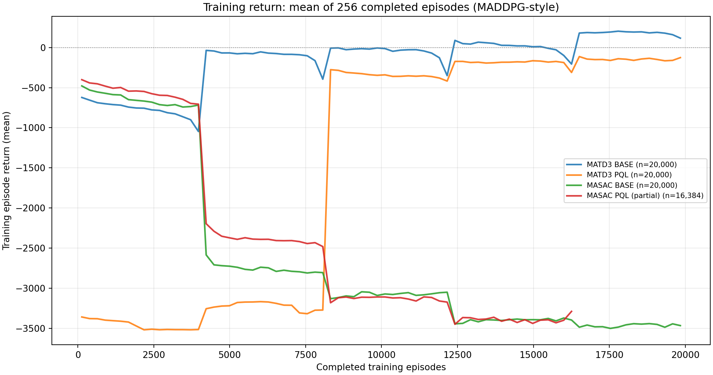
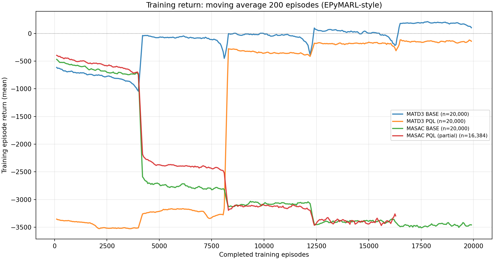
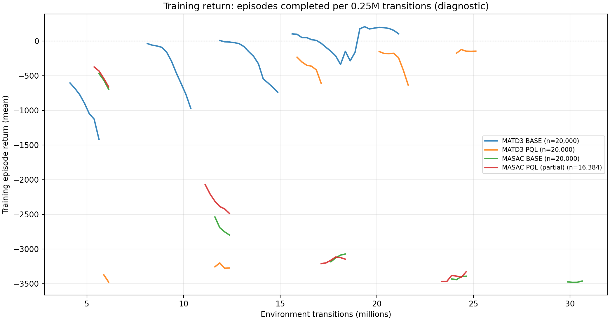

# Training-reward plotting comparison — exploratory W&B snapshot

Run on 2026-11-08 using **existing W&B training history** (read-only), not new training, validation, or a new reward definition. These figures are method previews and **must not be presented as held-out results**.

## Precisely identified training runs

| Label | W&B run ID | Episode records | Provenance |
|---|---|---:|---|
| MATD3 BASE (default initialization) | `971f7cc2` | 20,000 | BASE, seed 44 |
| MATD3 PQL | `30bdc182` | 20,000 | PQL, seed 44 |
| MASAC BASE | `62cfc303` | 20,000 | BASE, seed 44 |
| MASAC PQL | `43494a2c` | **16,384, incomplete** | PQL, seed 44 |

All four W&B configs agree exactly on the `world`, `sensor`, `reward`, `energy`, and `network` subtrees: **6 UAV, 20 targets, 15 obstacles, 1,000m map, 1,500 step horizon**. These are **not** the newer proposed 35-target/25-obstacle configuration. They are individual, distinct runs with different learning algorithms/architectures; the plots are not cross-seed error-bar estimates. The MATD3 PQL/Base training loops differ, and MASAC PQL is incomplete. No numerical claim about comparative superiority or the final 35/25 scenario is justified from the pictures alone.

## Figures (source-inspired processing)

### 1. Completed-episode fixed-256 means

- [Open full figure](training_reward_mean256.png).
- Read `episode/return` from W&B history, sorted by `episode/index`; average each non-overlapping block of **256 completed episode records** (similar in spirit to the block averaging used in original MADDPG `experiments/train.py`, which uses its own configured interval). The final **32-episode partial block** of the 20k runs is omitted from the line to prevent a statistically incomparable last point.
- Original code reference: https://github.com/openai/maddpg/blob/master/experiments/train.py

### 2. Moving-average 200 episodes

- [Open full figure](training_reward_moving200.png).
- Sliding mean of 200 *training* episode returns, matching the averaging equation in EPyMARL's `plot_results.py::smooth_data`, then downsample every 50 smoothed points for chart display only. No eval data was substituted.
- Code reference: https://github.com/uoe-agents/epymarl/blob/main/plot_results.py

### 3. Global-step-binned completed-episode reward: diagnostic only

- [Open full figure](training_reward_stepbins.png).
- Average reward of episodes **that completed during each 250,000 environment transitions**. Intervals containing fewer than five completed episodes are omitted, not interpolated. Gaps are expected because of 4,096 parallel environments. Unlike the two methods above, this is a diagnostic proposal, **not copied from a research paper**. Do not mislabel it as a continuous average of all active environments or use it as the headline result without caveats.

## Observed outcomes, limitations, and how to rerun

- Completed-episode averaging and moving average **both retain abrupt, large step changes** around the 4,096-episode cohort boundaries. More smoothing does not establish that these jumps are actual policy improvements, and the plotted values also do not establish a specific learner bug. Training Return is **in-sample**, affected by episode lengths and collection completion order; fixed-policy validation return is a separate source.
- In the first/last **complete 256-episode block**, MATD3 BASE is about **-622 / +118**, MATD3 PQL **-3360 / -125**, MASAC BASE **-478 / -3467**, MASAC PQL **-401 / -3290** (last MASAC PQL block at 16,384 episodes, not 20,000). These are *means over collected training episodes*, not Final Test return.
- Retained W&B History source keys: `episode/index`, `episode/return`, `episode/length`, `global_step`. Cache and unabridged numeric analysis JSON were generated in local `outputs/reward-method-study/` (git-ignored), not committed with the images. No run metrics were overwritten or backfilled in W&B.
- To regenerate using existing W&B API access, from the repository root run `PYTHONPATH=. python scripts/plot_training_reward_from_wandb.py --key-file /home/aduy/Documents/NCKH/uav_network/key.txt` or supply `--run 'LABEL=ID'` repeatedly to choose new runs. Never commit API keys. Figures are in `outputs/reward-method-study/`.
- For the paper, a more defensible policy-convergence curve would use independent-seed evaluation return with enough checkpoints, if these noisy/misleading training-return views are rejected. Validation cadence and checkpoint selection remain unchanged in the code until an explicit follow-up request.
