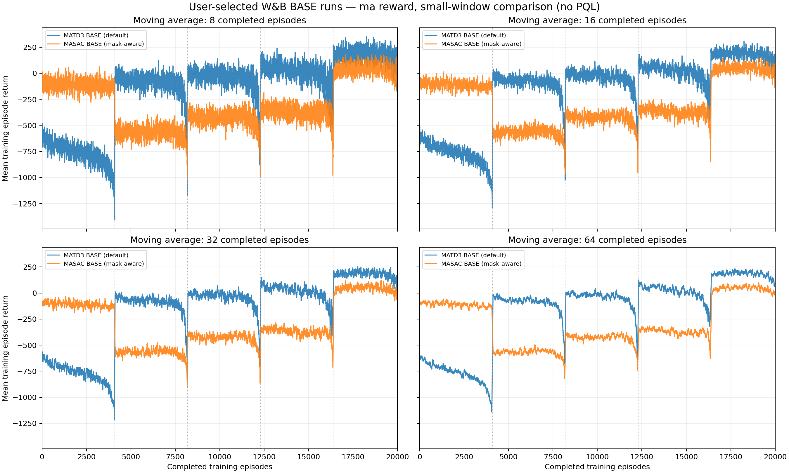
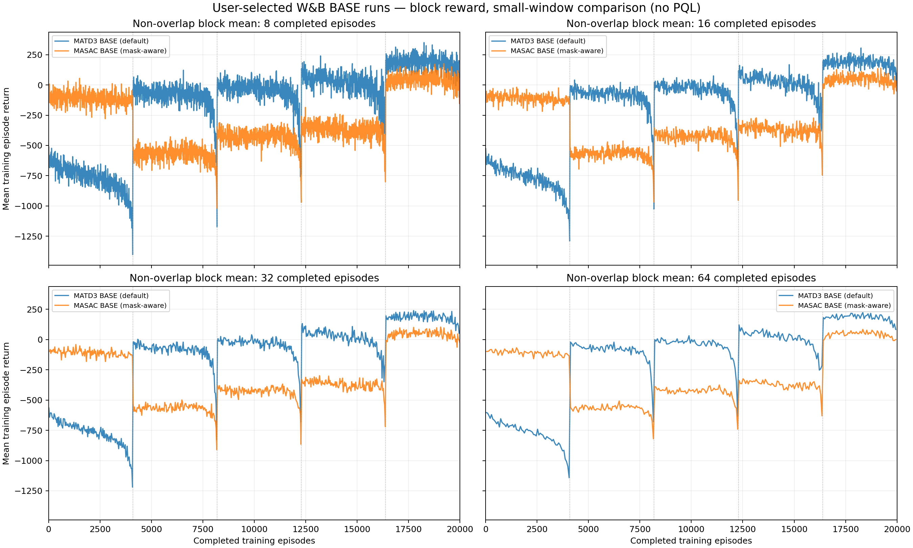
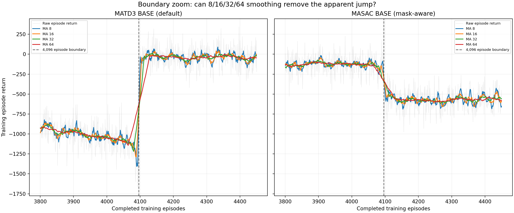

# Training Reward, small-window preview — user-selected BASE runs (2026-11-08)

This is a **read-only W&B training-return comparison**, with no PQL, no Kaiming MATD3. The user explicitly chose these two runs, not the latest one by creation time:

| Label | Exact W&B identity | Created (UTC) | Episode records |
| --- | --- | --- | ---: |
| MATD3 BASE, default initialization | `MATD3-BASE-SH-NOCHUNK-DEFAULT-S44-971f7cc2` | 2026-11-06 16:10:27 | 20,000 |
| MASAC BASE, mask-aware discrete entropy | `MASAC-BASE-SH-NOCHUNK-MASKAWARE-S44-f6a196a7` | 2026-11-06 15:24:42 | 20,000 |

Same environment and seed 44: **6 UAVs, 1,000m map, 20 targets, 15 obstacles, max 1,500 steps**, 4,096 parallel environments. Both use 8 updates per step and shared actors/critics. **Different algorithm and special options** (MATD3 default initialization versus MASAC mask-aware entropy), so this is an exploratory comparison of specified runs, *not* a claim of a controlled single-factor ablation. These are not the newer 35-target/25-obstacle scenario.

## Generated figures from the raw `episode/return` training history

**Moving-average comparison** with four separate windows of 8, 16, 32 and 64 *consecutive completed episodes*. All window means are retained; no post-smoothing decimation.

**Non-overlapping mean comparison**, with each point using 8, 16, 32 or 64 completed episodes, and incomplete final blocks omitted.

**Zoom near the 4,096 completed-episode boundary**, with raw return faintly overlaid behind the 8/16/32/64 moving-average estimates:

Additional separate 16, 32 and 64-episode PNG plots are next to these three files.

## Observation

- Both algorithms still have a sharp change around **4,096 completed episodes** even at moving-average window 8. These shifts are *in the source episode records*, so 200-episode smoothing was not their sole cause.
- Comparing 64 raw episode returns immediately before versus immediately after that boundary: MATD3 mean Reward changes from **−1142.09 to −20.45** (Δ +1121.64); MASAC changes from **−135.49 to −560.81** (Δ −425.32). Other changes also occur near 8,192, 12,288 and 16,384.
- With 4,096 environment workers and completion-order logging, this is **consistent with episode cohort effects**. It does not prove that reward changes are artificial or that the policy suddenly changed at the displayed index. Both real policy learning and episode length differences can contribute.
- The user can prefer **MA 32** to balance detail with noise, but it must be labeled *training reward, moving average 32 episodes*. None of these plots is the held-out fixed-policy Validation Reward or the Final Test score.

## Source and rerun

- Original GitHub comparison code: `scripts/plot_latest_base_small_reward_windows.py`.
- W&B source: `https://wandb.ai/truongdaoanhduy-uit/uav_search_target/runs/971f7cc2` and `https://wandb.ai/truongdaoanhduy-uit/uav_search_target/runs/f6a196a7`.
- Rerun from project root, with the credential already on the user's machine: `PYTHONPATH=. python scripts/plot_latest_base_small_reward_windows.py --matd3-id 971f7cc2 --masac-id f6a196a7`.
- Numeric JSON and complete lossless History caches stay in local `outputs/reward-small-window-default-matd3-maskaware-masac/` and are intentionally not uploaded to GitHub.
- No changes to W&B Workspace, training algorithms, PQL, checkpoint frequency, validation schedule, baseline reward function or Kaggle notebooks.
