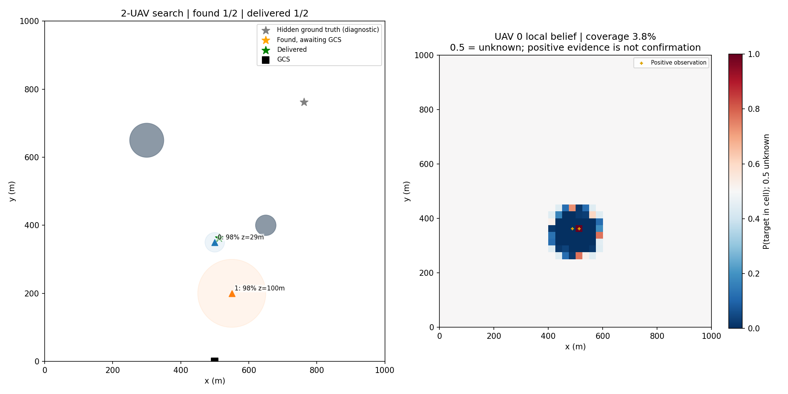

# XYZ sensing/Bayes và visualize 2D

Đã triển khai theo thiết kế được duyệt ngày 30/10/2026. Ba YAML mới có hậu tố
`-xyz-sensing.yaml`; YAML XY gốc vẫn là baseline đối chiếu và vẫn đọc được
checkpoint cũ. Không tự đổi một run XY đang có thành run XYZ.

## Các profile

| Profile | Actor/critic | Replay |
| --- | --- | --- |
| comparison-20k-hybrid75-1kb-xyz-sensing.yaml | Riêng từng UAV | 75% CPU / 25% GPU |
| comparison-20k-hybrid75-1kb-shared-actor-critic-xyz-sensing.yaml | Chia sẻ cả hai | 75% CPU / 25% GPU |
| comparison-20k-fullgpu-1kb-shared-actor-critic-xyz-sensing.yaml | Chia sẻ cả hai | FullGPU |

Giữ 6 UAV, map 1 km, 20 target/15 obstacle, 1200 bước, 20k episode,
E4096, batch8192, replay1M, FP32; report/payload1024 B, buffer3 report,
TTL300 s, pin277200 J, RF learned0.001..0.4 W. Các giá trị này chưa được
xác nhận vừa VRAM trên phần cứng CUDA trong lần triển khai này.

## Camera, belief và confirmation

- Bay XYZ thật; action continuous là `[ax, ay, az, power]`, cùng action
  discrete chọn receiver/im lặng. Giữ giới hạn tốc độ/gia tốc và an toàn.
- Độ cao0..150m, ban đầu100m. Vật cản có chiều cao sinh trong30..120m.
- Grid25m, belief riêng từng UAV, ban đầu mỗi ô0.5. Coverage ghi riêng,
  không đồng nhất với xác suất có target.
- FOV90 độ: bán kính vùng nhìn bằng độ cao. Bay cao nhìn rộng hơn nhưng
  Pd giảm/Pf tăng: mốc0/50/100/150m là
  Pd0.99/0.90/0.80/0.70 và Pf0.01/0.10/0.20/0.30.
- Chỉ đo ô thuộc footprint có LOS; xử lý phần diện tích ô bị FOV cắt.
  Quan sát dương tăng posterior, quan sát âm giảm posterior.
- Chỉ xác nhận khi UAV active, z<=50m, posterior>=0.99 và có quan sát dương mới.
  Posterior cao lúc bay cao vẫn chưa tạo report.
- False positives vẫn có thể xảy ra. Không dùng target truth để âm thầm sửa
  posterior về0.01. Simulator chỉ dùng truth để sinh phép đo và ghi đánh giá;
  actor nhận ô/cell-center quan sát được, không nhận tọa độ target chưa xác nhận.
- Belief/geometry dùng float64 để khớp mô hình tham chiếu; learner vẫn FP32.
  Full map lưu trong simulator/full resume. Actor dùng patch belief5x5;
  critic dùng biểu diễn gọn có các patch này, không phải toàn bộ trạng thái Bayes.

Native và Warp cùng dùng sensing theo tick/seed/UAV/cell. Đọc observation,
info hoặc render không lấy thêm mẫu. Resume giữ cả belief, độ cao, vận tốc z,
coverage và khóa sampling. Checkpoint XYZ có observation schema4; XY giữ3.
Không resume chéo hoặc diễn giải slot RF của checkpoint XY thành az.
Kiểm tra khớp train liền mạch dùng BASE serial/PQL synchronous và so weights,
mission records cùng toàn bộ world arrays. BASE overlap/PQL async có thứ tự
collection/update phụ thuộc việc drain khi kết thúc segment; không cam kết
bitwise giống một run không bị ngắt. Snapshot world vẫn giữ đúng lần đo kế tiếp
khi khôi phục cùng action.

## Truyền thông và đánh giá

Khoảng cách/range, LOS/NLOS, pathloss, propagation và admission sử dụng XYZ thực.
Camera dùng hình trụ tròn; RF giữ footprint đa giác hữu hạn chiều cao của
UavNetSim. Giữ giới hạn công suất, contention, SINR, ACK/retry, custody và TTL.
Relay tiếp tục là quyết định policy.

Giữ periodic validation và validation-best checkpoint. Full checkpoint cuối
dùng để resume; best actor dùng cho đánh giá. Không chọn best bằng final-test bank.
Study manifest XYZ có tên và case ID chứa `xyz-bayes`; không ghi đè study XY.

Oracle feasibility cũ chỉ hỗ trợ XY và sẽ báo rõ khi nhận profile XYZ.
Chưa có kết quả oracle chứng minh giao đủ20/20 cho XYZ; demo dưới đây chỉ
kiểm tra đường đi sensing → report → GCS.

Tổng số can thiệp an toàn XYZ được ghi nhận. Các trường phân loại riêng
obstacle/peer/boundary chưa được triển khai cho XYZ và hiện giữ giá trị0;
không dùng các số0 này để kết luận không có tránh vật cản hay tránh UAV.

## Chạy

Ví dụ train MASAC shared actor/critic Hybrid:

```bash
python -m uav_network train \
  --config configs/comparison-20k-hybrid75-1kb-shared-actor-critic-xyz-sensing.yaml \
  --algorithm masac
```

Đổi `--algorithm matd3` để chạy MATD3. Muốn PQL thêm
`--set pql.enabled=true`; MATD3 PQL dùng chính sách acceleration hiện có
(trong study planner, compile được tắt cho mode này).

Tạo các case baseline trên nhiều training seed, chưa chạy job:

```bash
python -m uav_network study plan \
  --config configs/comparison-20k-hybrid75-1kb-shared-actor-critic-xyz-sensing.yaml \
  --output-dir outputs/xyz-baseline-study --variants baseline
```

## Visualize

Bản đồ, quỹ đạo và mũi tên report vẫn chiếu lên XY, không tạo plot3D.
Nhãn UAV có z/pin; vòng FOV thay đổi theo độ cao từng frame.
Heatmap bên cạnh là belief của UAV0, thang0..1, màu giữa0.5 là chưa biết;
dấu cộng là quan sát dương, không phải target đã được xác nhận.

Demo có thể chạy lại bằng:

```bash
python -m scripts.demo_xyz_camera --output-dir outputs/xyz-camera-demo-new
```

Demo dùng 2 UAV/2 target/2 obstacle và bộ điều khiển độ cao lập trình sẵn
để kiểm sensing và đường truyền. Nó không phải kết quả MASAC/MATD3 đã học.
Lần chạy seed44,60 bước: xác nhận1 target, giao1 report về GCS.
Các hình trong evidence chỉ minh họa pipeline này.



[Animation 2D của demo](superpowers/evidence/xyz-camera-demo-20261030.gif).

## Bộ nhớ và giới hạn bằng chứng

Profile mới có observation173, critic features565, continuous4.
Replay1M cần12,976,000,000 B (~12.085 GiB), chưa gồm khoảng9MB measurement arrays.
Warp4096 ước tính~2.629 GiB, cộng buffer observation thứ hai và model/optimizer.
Các vai collector/learner/replay có thể nằm trên GPU khác nhau; không cộng
vào một GPU khi chưa xác định placement. Activation/context/allocator chưa nằm
trong các số tĩnh này. Không tự giảm E/B/replay hoặc bật AMP.

Xem [số liệu byte cụ thể](superpowers/evidence/2026-10-30-xyz-resources.json).
Đã kiểm Native/Warp CPU, train/evaluate nhỏ và render; chưa chạy study20k,
chưa xác nhận hiệu năng/VRAM CUDA hoặc hội tụ của policy XYZ.

[Bằng chứng kiểm thử, reset kernel và trạng thái CUDA](superpowers/evidence/2026-10-30-xyz-sensing-verification.md).

[CUDA preflight và sửa sao chép struct](superpowers/evidence/2026-10-31-xyz-cuda-preflight.md).
